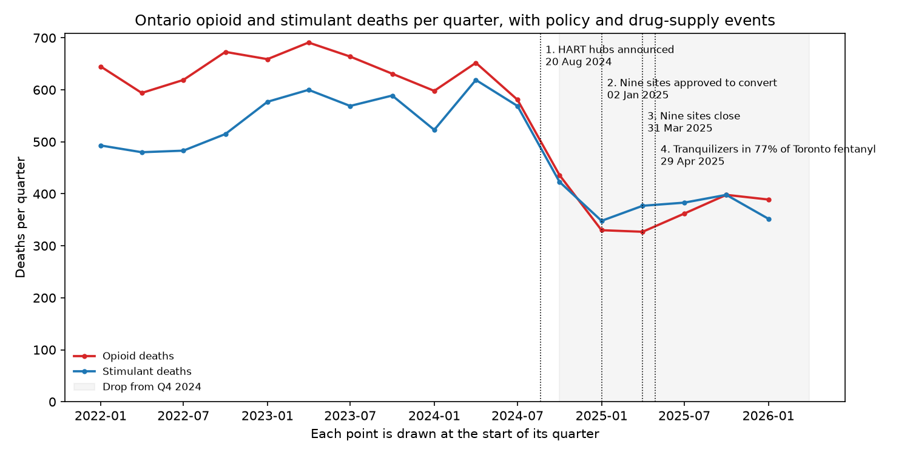
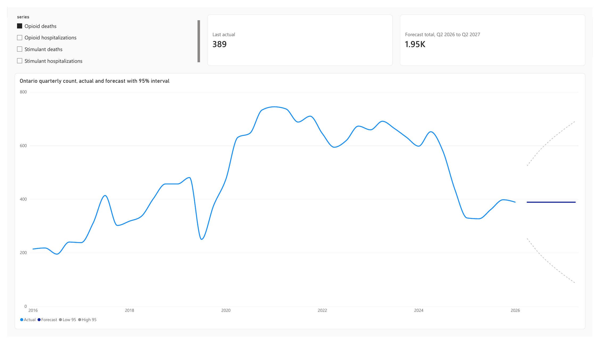
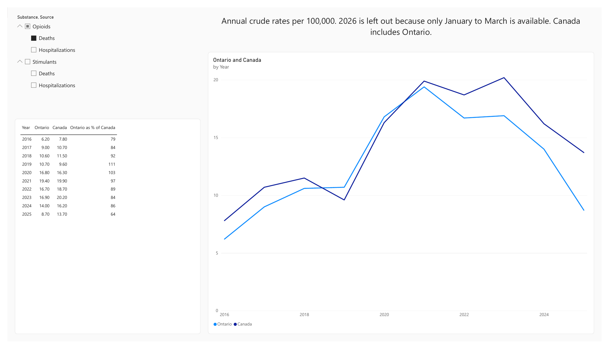
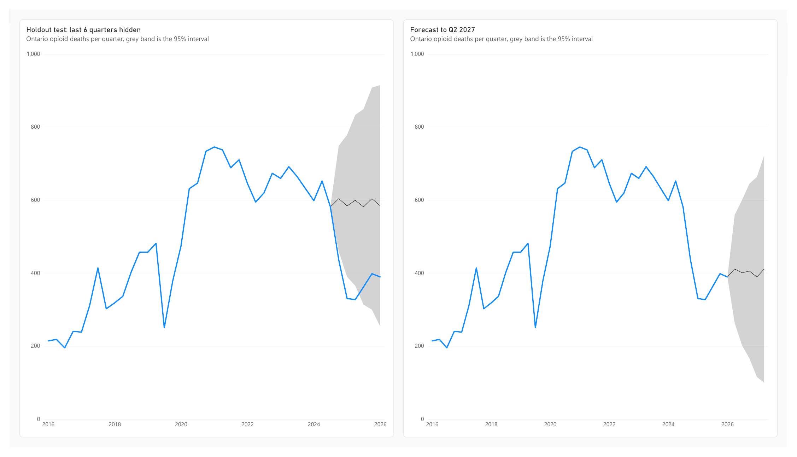

# Ontario Substance Harms Forecast

How many opioid and stimulant related deaths and hospitalizations should Ontario expect from Q2 2026 to Q2 2027, how wide is the uncertainty, and does Ontario's trend follow Canada's?

Status: Python, Excel, R and Power BI versions done. The working plan is in [SCOPE.md](SCOPE.md).

## Data

The source is the Public Health Agency of Canada's opioid and stimulant harms data on Health Infobase (https://health-infobase.canada.ca/substance-related-harms/opioids-stimulants/), downloaded 25 October 2026 as `data/raw/SubstanceHarmsData.csv`. The file has 33,250 rows covering deaths, hospitalizations, emergency department visits and EMS responses for Canada and each province and territory, by year and by quarter. 4,543 values are marked "Suppr.".

The series used here are Ontario and Canada overall quarterly counts:

- Opioid toxicity deaths, Q1 2016 to Q1 2026 (41 quarters)
- Stimulant toxicity deaths, Q1 2018 to Q1 2026 (33 quarters)
- Opioid-related poisoning hospitalizations, Q1 2016 to Q1 2026
- Stimulant-related poisoning hospitalizations, Q1 2016 to Q1 2026

None of these Ontario series has a suppressed quarter. Ontario EMS responses start in 2017 and have five suppressed quarters, so they are left out. Annual crude rates per 100,000 are used to compare Ontario with Canada.

Ontario's counts dropped sharply at the end of 2024. Opioid deaths were 581 in Q3 2024, 436 in Q4 2024 and 330 in Q1 2025, and stayed between 327 and 398 through Q1 2026. Stimulant deaths fell from 569 to 348 over the same three quarters.

## Method

Models are fit on Q1 2016 to Q3 2024 and tested on Q4 2024 to Q1 2026, the six quarters from the start of the drop. A seasonal naive baseline, Holt's exponential smoothing with a damped trend and an ARIMA chosen by AIC are compared on MAE and MAPE. The final forecasts use all quarters, with and without a level-shift term from Q4 2024, and report 80% and 95% prediction intervals. The same forecasts are repeated in Excel and R, and a Power BI report shows them with the forecast visual.

## Results

Every model over-forecast the holdout, because none of them could anticipate the drop that began in Q4 2024. For Ontario opioid deaths the best model, ARIMA(0,1,0), was off by 207 deaths a quarter on average (MAPE 57%), and only 3 of the 6 actual quarters fell inside its 95% interval. The seasonal naive baseline was off by 242 (MAPE 66%). For stimulant deaths the seasonal naive and ARIMA(0,1,0) tied at about 189 (MAPE 50%). Hospitalizations were easier: damped Holt had a MAPE of 25% for opioids, and ARIMA(2,1,2) had 17% for stimulants. Full results are in `results/holdout_metrics.csv`.

Refit on all quarters, the ARIMA forecast for Ontario opioid deaths is 389 a quarter from Q2 2026 to Q2 2027, with a 95% interval of 254 to 524 in Q2 2026 widening to 87 to 691 by Q2 2027 (level-shift version). The level-shift term changed the opioid hospitalization forecast most: 452 for Q2 2026 with it and 479 without. All forecasts are in `results/forecasts.csv` and the charts in `images/`.

The three tools agree on the main result. R's auto.arima picked the same ARIMA(0,1,0) for opioid deaths as the Python search, with the same holdout MAE of 207.3 and the same forecast of 389 a quarter. Excel's FORECAST.ETS did worst on opioid deaths (MAPE 84%) because it carried the upward trend forward; R's ets() chose a model without a trend and had a MAPE of 58%.

Ontario's 2025 drop was larger than Canada's. Ontario's opioid death rate fell from 14.0 per 100,000 in 2024 to 8.7 in 2025 (down 38%), while Canada's fell from 16.2 to 13.7 (down 15%). Ontario's stimulant death rate fell from 13.2 to 9.3, and Canada's from 14.2 to 13.3. From 2019 to 2021 Ontario's death rates were at or slightly above Canada's for both substances. Ontario's hospitalization rates have been below Canada's in every year since 2016. Canada's totals include Ontario, so the gap with the rest of the country is larger than these figures show. The rates are in `results/ontario_vs_canada_rates.csv` and the chart is `images/ontario_vs_canada_rates.png`.

The provincial policy changes do not explain when the drop began. `images/event_timeline.png` marks three dated policy events from Google News and one drug-supply event (listed with links in `data/events.csv`): Ontario announced HART hubs and a ban on supervised consumption sites near schools on 20 August 2024, approved nine sites to become HART hubs on 2 January 2025, and the nine sites were due to close at the end of March 2025. Opioid deaths had already fallen from 581 in Q3 2024 to 436 in Q4 2024 and 330 in Q1 2025 before any site closed. The decline was also national: opioid deaths fell 15.4% in Ontario in 2024 (2,638 to 2,231) and 17.1% across Canada ([CATIE, 1 August 2025](https://www.catie.ca/prevention-in-focus/reported-drug-toxicity-deaths-dropped-in-parts-of-canada-in-2024-but-whats)). CATIE lists possible causes, none of them proven: lower fentanyl concentration in the unregulated supply, more sedatives such as benzodiazepines and xylazine in it, a shift from injecting to smoking, fewer people using drugs, and the deaths of many people at highest risk in earlier years. A search of Canadian news from June 2024 to June 2025 found no drug-supply change with an exact date before the drop, so the monthly values were read from the tooltips of Toronto's Drug Checking Service dashboard ([Tableau Public](https://public.tableau.com/app/profile/karen.mcdonald5803/viz/Newproposedwebsitevizs/DB-Noteworthydrugsinexpectedfentanylsamples), read 25 November 2026; the service does not allow data download). The share of expected-fentanyl samples with a veterinary tranquilizer (xylazine or medetomidine) was 25.0% in Q3 2024 and 42.9% in Q4 2024. October 2024 was the first month above half: 51% (120 of 236), with medetomidine in 33% and xylazine in 22%. The monthly counts are in `data/drug_checking_tranquilizers_monthly.csv`. The chart marks October 2024. The share then rose to 76% in March 2025, in line with the service's report of 81% for 22 February to 7 March 2025 ([CBC News](https://www.cbc.ca/news/canada/toronto/veterinary-tranquilizers-fentanyl-testing-toronto-1.7484674)). The service first found medetomidine in December 2023 (4 of 112 samples). In the same months the main opioid changed: fluorofentanyl fell from 81% of samples in August 2024 to 15% in January 2025, and methylfentanyl-related drugs rose from 28% to 65% in November 2024. A high-potency opioid was in 87% to 99% of samples in every month. The service's "Amount of drugs found" table shows that fentanyl became weaker in the same month: in expected-fentanyl samples that contained fentanyl, the median fentanyl amount was 4.4% of the sample in July 2024 and 5.0% in August 2024, then 1.3% in October 2024 and 0.7% in November 2024, and it stayed at 2.0% or less in every month to November 2026. The monthly medians, middle-50% ranges and sample counts from January 2023 to June 2025 are in `data/drug_checking_fentanyl_amount_monthly.csv`. These values include only samples where fentanyl was found, so part of the fall can come from a change to fentanyl analogues and not only from a weaker supply, and the monthly counts before October 2024 are small (32 to 63 samples). These are Toronto samples from people who chose to use the service, and sample counts rose from 136 in September 2024 to 270 in November 2024. The supply change and the drop start in the same quarter, but this does not show that one caused the other. The events are annotations only and are not inputs to any model.

## Power BI Report

`powerbi/ontario_forecast.pbix` has three pages, also exported as `powerbi/ontario_forecast.pdf`. The first shows each Ontario series with the Python ARIMA forecast and its 95% interval. The second compares Ontario and Canada annual rates. The third uses Power BI's built-in forecast on opioid deaths: with the last six quarters hidden it predicted about 600 deaths a quarter for Q4 2024 to Q1 2026, the same over-forecast as the other tools.

## Diagrams

Health Infobase CSV to holdout tests, forecasts, Excel and Power BI, plus the event chart and the drug-checking values read from the Toronto dashboard.

How each series moves through 02_holdout_and_forecast.py.

Ontario policy dates, Toronto drug-checking values and Ontario opioid deaths from August 2024 to March 2025 (dates show month and day). Drug-checking values are monthly and drawn on the first day of the month. Death counts are quarter totals drawn at mid-quarter.

CATIE's possible causes of the drop, grouped by what this project's data can show. "Supported" means the Toronto data show the change in the same quarter as the drop. It does not show cause.

## Files

`scripts/01_load_and_profile.py` reads the raw CSV, lists every Ontario and Canada series with its first and last period and its count of missing values (`data/processed/series_inventory.csv`), and writes the quarterly counts in long form (`data/processed/quarterly_on_ca.csv`).

`scripts/02_holdout_and_forecast.py` fits the three models on Q1 2016 (Q1 2018 for stimulant deaths) to Q3 2024, scores them on Q4 2024 to Q1 2026, refits ARIMA on all quarters with and without a level-shift dummy, and writes the results and charts.

`scripts/03_ontario_vs_canada.py` compares annual crude rates for 2016 to 2025 (2026 has only January to March).

`scripts/04_build_excel.py` builds `excel/ontario_forecast.xlsx`, which repeats the holdout test and the forecast with Excel formulas (FORECAST.ETS and FORECAST.ETS.CONFINT, seasonality 4) next to a seasonal naive baseline.

`scripts/05_forecast.R` repeats the holdout test and forecast in R with the forecast package (snaive, ets, auto.arima, and auto.arima with a level-shift regressor). It writes `results/r_holdout_metrics.csv`, `results/r_forecasts.csv` and `images/r_forecast_<series>.png`. Run it with `Rscript scripts/05_forecast.R` after script 01; it needs the forecast package.

`scripts/06_powerbi_export.py` writes `powerbi/powerbi_quarterly.csv` (actual counts for Ontario and Canada plus the Ontario forecasts with interval bounds). `powerbi/POWERBI_STEPS.md` has the steps for building the report.

`scripts/07_event_timeline.py` draws Ontario opioid and stimulant deaths per quarter from Q1 2022 with the events in `data/events.csv` and writes `images/event_timeline.png`.

To run them: `pip install -r requirements.txt`, then run the Python scripts in number order from the repository root. Script 05 needs R and the forecast package.

## Limitations

Recent quarters are preliminary and Health Infobase revises earlier quarters with each release, so results depend on the download date. Death and hospitalization counts come from different systems (coroners and medical examiners for deaths, hospital discharge records for hospitalizations), and definitions vary by province. A forecast extends past patterns and cannot anticipate a change in the drug supply or in policy.

## Tools

Python (pandas, statsmodels), R, Excel, Power BI.

## Data licence

Health Infobase data are published under the Open Government Licence - Canada. Code in this repository is under the MIT License.
